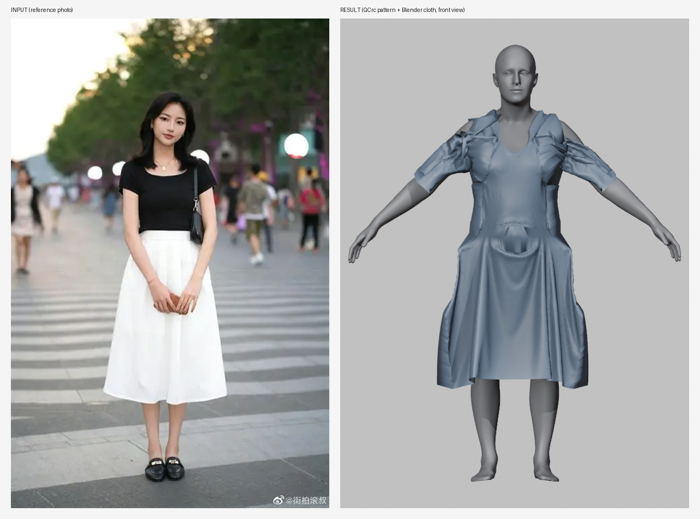
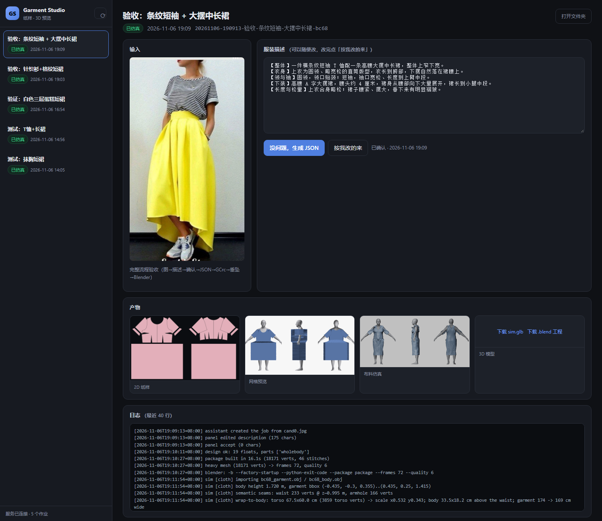
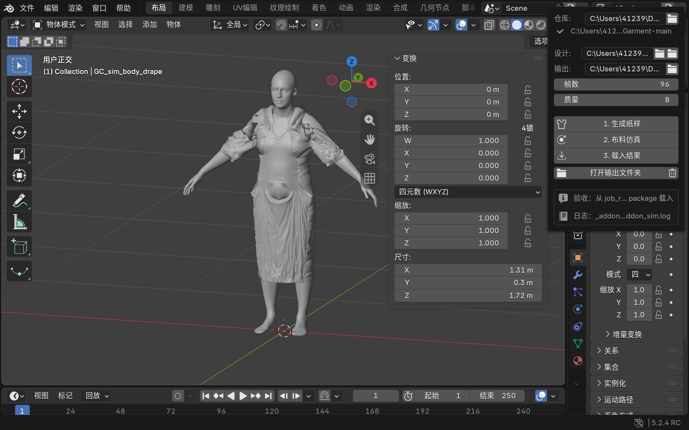
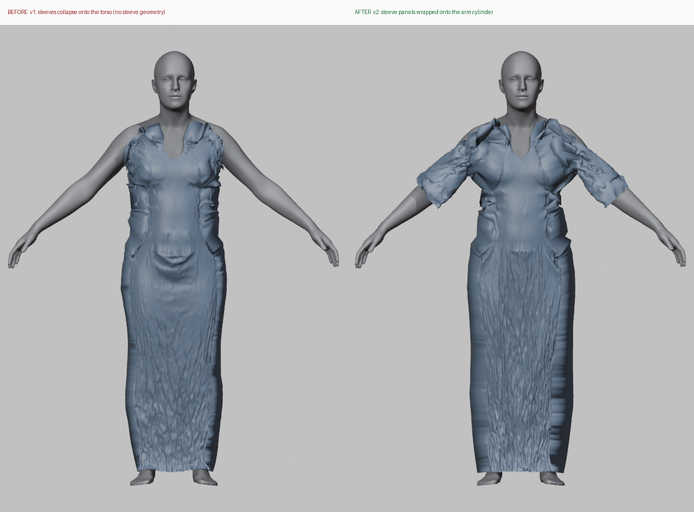
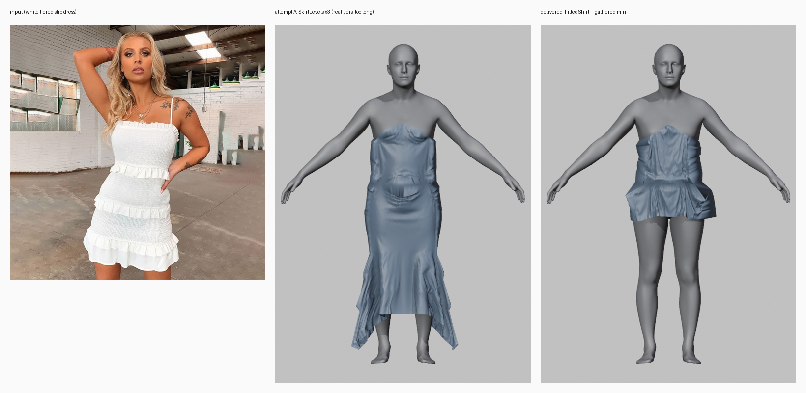

# Drapewright

**从一张照片或一句话，到可仿真、可继续修改的 3D 服装。**
*A Blender-friendly studio on top of [GarmentCodeRC](https://github.com/humanmotion/GarmentCodeRC) and [ChatGarment](https://github.com/ChongjiWang/ChatGarment).*

把"设计意图"变成纸样，再把纸样变成真正挂得住的布——中间不做黑盒网格生成。产出是可编辑的
2D 裁片、可仿真的 3D 网格和一份 Blender 工程，设计师可以继续改。


## 它是怎么工作的

```
参考图 ──► 视觉语言模型 ──► 服装文字描述 ──►（人来确认/修改）
                                              │
                                              ▼
                                    结构 JSON（GCrc 参数）
                                              │
                          GarmentCodeRC ──► 2D 纸样 + 缝合关系
                                              │
                                  BoxMesh ──► 3D 网格（含裁片语义）
                                              │
                                   Blender ──► 布料仿真（垂坠/褶皱）
                                              │
                             .glb / .blend / 三视图 / 纸样 PNG
```

关键取舍：

- **数字不交给模型猜。** 文字描述负责"款式"，几何数字由人给或按模板给，避免"合法但荒谬"的端点值。
- **每步都有中间产物。** 纸样错了不启动 Blender，Blender 崩了不丢纸样；每一步都能单独重跑。
- **人来把关。** 描述先给人看，确认或改字之后才生成 JSON。
- **产物是一个"包"，不是一个文件。** 见下文的作业目录。


## 效果

**1. 一张街拍 → 纸样 → 布料垂坠。** 左：输入；右：GCrc 生成的纸样 + Blender 布料仿真（正面）。



**2. 浏览器面板。** 左边是作业列表，中间是模型写的服装描述（可以改），右边是产物：2D 纸样、网格预览、三视图仿真、`.glb` / `.blend` 下载。



**3. Blender 侧栏插件。** 装好 `gcstudio` 后，3D 视图侧栏出现 `GC Studio`：生成纸样 / 布料仿真 / 载入结果，结果以 `GC_` 前缀对象落进场景。



**4. 袖子：修复前后。** 左：v1 袖片塌进躯干；右：v2 把袖片卷到手臂圆柱上（170° 包角，不重叠）。



**5. 一个做不到的款式（诚实记录）。** 想复刻三层蛋糕短裙，`SkirtLevels` 的层高固定，裙长最短也到脚踝；最终换成 `Skirt2` + 抽褶交差。左：参考图；中：三层尝试；右：交付版。




## 快速开始（Windows）

前置：Python 3.11、Blender 4.x/5.x、NVIDIA 显卡（可选，布料仿真纯 CPU 也能跑）。

环境准备（venv、torch、GarmentCodeRC、模型权重）见 **[`win/README.md`](win/README.md)**。装完之后：

```bash
# 1. 一套纸样 + 3D 网格（约 15 s，纯 CPU）
./.venv/Scripts/python.exe -m studio.core.cli build \
    --design cases/rc_dress/design.json --out studio/runs/demo

# 2. 布料仿真（约 1–3 min）
BLENDER=/c/Users/<you>/Desktop/blender-<ver>/blender.exe \
  ./.venv/Scripts/python.exe -m studio.job_runner <job_id> --frames 96 --quality 8
```

想要图形界面：双击 `win/studio.bat`，浏览器打开 <http://127.0.0.1:8765/>。
想要在 Blender 里点按钮：安装 `studio/blender_addon/dist/gcstudio-*.zip`（编辑 → 偏好设置 → 插件 → 从磁盘安装），
3D 视图侧栏会出现 **GC Studio** 标签页。


## 目录

| 路径 | 职责 |
| --- | --- |
| `studio/core/` | 参数 schema → GCrc → 纸样 → OBJ 的构建管线 |
| `studio/sim/` | Blender 布料仿真（导入、缩放、钉合、烘焙、导出） |
| `studio/panel/` | 浏览器面板（作业列表、描述审阅、产物预览） |
| `studio/server.py` | 面板的本地 HTTP 服务（纯标准库） |
| `studio/jobs.py` | 作业目录协议（request/description/approval/design/package/result） |
| `studio/agent.py` | 给模型用的命令行（new / describe / template / wait / run / show） |
| `studio/blender_addon/` | Blender 侧栏插件（只提交作业，不自己算几何） |
| `studio/dsh-plugin/` | DSH 侧栏插件（把人工确认投回会话） |
| `docs/STUDIO_SPEC.md` | 技术方案与实测数据 |
| `docs/GC_STUDIO_SKILL.md` | 模型操作手册（六步流程 + 反模式） |
| `win/README.md` | 本机（Windows）环境搭好之后的完整说明 |


## 作业目录（产物是"包"）

```
<job_id>/
  request.json       # 输入图、标题、来源会话
  description.txt    # 服装文字描述（人可改）
  approval.json      # 人的确认：accept / edit + 改后文本
  design.json        # 结构参数（归一化浮点）
  package/
    manifest.json    # 这个包的清单与来源
    sidecar.json     # 裁片语义：面板、缝线、钉点
    pattern/         # 2D 纸样 PNG + specification.json
    mesh/            # 3D 网格（未仿真）
    sim/             # sim.glb / sim_drape.blend / 三视图 / sim.json
  result.json        # 成功或失败，含耗时与警告
```


## 已知边界

- **只支持整件式（`wholebody_garment`）**：上下装拆开需要两份纸样，当前会被显式拒绝而不是静默丢掉。
- **袖子是"大概对"**：袖片卷到手臂圆柱上，袖窿环尚未钉到皮肤，肩部会有碎褶（v2 待改进）。
- **集合裙的层高由 GCrc 固定**：`SkirtLevels` 做不了超短多层裙，需要换 `Skirt2` + 抽褶。
- **不含颜色/材质/印花/拉链/口袋**：这些不在 GCrc 的表示里。
- **8 GB 显存够用**：4-bit 量化模型；布料仿真纯 CPU，一件约 1–3 分钟。


## 与上游的关系

本仓库包含 [ChatGarment](https://github.com/ChongjiWang/ChatGarment)（Apache-2.0）的源码副本，
并在其上叠加 `studio/` 这一层。纸样生成依赖 [GarmentCodeRC](https://github.com/humanmotion/GarmentCodeRC)
与其数据（`assets/`、`repos/GarmentCodeRC-main/`），模型权重与数据集**不在本仓库内**，需按上游文档自行获取。

模型权重、`runs/`、`repos/`、`.venv/`、`studio/jobs/`、`studio/runs/`、`*.blend`、`*.glb` 均在
`.gitignore` 中隔离，不会进入版本库。


## 许可

本仓库叠加部分（`studio/`、`win/`、`docs/STUDIO_SPEC.md`、`docs/GC_STUDIO_SKILL.md`）遵循 Apache-2.0；
上游 ChatGarment 代码保留其原始版权与许可（见 `LICENSE`）。
