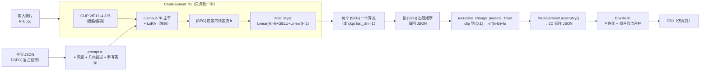

# 绕过 VLM 手写 JSON → 数字头 → GarmentCodeRC → 3D：实验记录

日期：2025-11-05　机器：Windows + RTX 5060 Laptop 8 GB　仓库：`C:/Users/41239/Desktop/科研/ChatGarment-main`
输入图：`cases/rc_dress/input.jpg`（来源 `C:/Users/41239/Desktop/科研/R-C.jpg`，街拍：薄荷绿抹胸紧身短连衣、下摆荷叶边）

## 0. 一句话结论

**链路跑通了**：手写 JSON → 官方数字头（`float_layer`）→ GarmentCodeRC 纸样 → 3D 网格（OBJ），全程无人工干预，单次前向 7–9 秒。
**但数字头在这个用法下不可靠**：手写 JSON 与训练格式不一致时，7 个回归值大量落在 [-2, 2]（合法域是 [0, 1]），clip 之后全部贴到区间端点，衣服退化成“上下一般粗的直筒”。
**3D 产物是“仿真前”网格**：本机装不上 warp（GarmentCode 需要自维护 fork 的 `wp.sim`），所以版片还没有被布料仿真拉合，呈现“摊开的筒”。

## 1. 这条链路长什么样



关键点：**我们跳过的只是“让 LLM 逐 token 写出文本”**，图像照样过 CLIP，数字照样由官方 `float_layer` 给出，下游完全是官方代码。

## 2. 这次写/用到的文件

| 文件 | 作用 |
|---|---|
| `scripts/bypass_vlm_from_json_1float.py` | 核心：载入官方 ckpt（4-bit NF4），把手写答案 teacher-force 进 prompt，**单次 forward** 取 `hidden_states[-1]` 过 `float_layer`，再调官方 `run_garmentcode_parser_float50` |
| `win/run_bypass_json.sh` | 启动器：与 `win/run_eval_imggen.sh` 共用同一套 env 和 HfArgumentParser 参数，末尾转发 `--image/--answer_json/--tag/--out_dir/--dry_floats/--answer_mode/--description_file` |
| `cases/rc_dress/answer.json` | 我手写的紧凑版 JSON（7 个 `[SEG]`）：`FittedShirt + strapless + Skirt2 + ruffle`，无领/无袖/无腰带 |
| `cases/rc_dress/answer_spaced.json` | 同上，但复刻官方生成文本的空格风格（`'length':  [SEG] ,`） |
| `cases/rc_dress/official_answer_raw.txt` | 官方模型对这张图的原始答案（33 个 `[SEG]`），用于做对照/校验 |
| `cases/rc_dress/official_description.txt` | 官方第一轮生成的几何描述（喂给第二轮） |
| `tools/spec_to_obj.py` | `*_specification.json` → `BoxMesh` → OBJ + 自制 z-buffer 三视图预览 PNG |
| `tools/extract_official.py` | 从官方 demo 的 `raw_qN.txt` 里抽出 `RAW=` 浮点 |
| `tools/dump_design_spec.py` | 打印 `design_used.yaml` 某路径的 type/v/range |
| `runs/bypass_rc/` | 四组产物：`dry`（纯手给浮点）、`rc_dress`（手写 JSON+数字头）、`rc_spaced`（改空格）、`rc_hand`（手给浮点+好参数） |

## 3. 复现命令

```bash
cd /c/Users/41239/Desktop/科研/ChatGarment-main

# (1) 只验管线、不加载模型：手给 7 个浮点
bash win/run_bypass_json.sh --image cases/rc_dress/input.jpg \
  --answer_json cases/rc_dress/answer.json --tag rc_hand \
  --dry_floats 0.2,0.05,0.0,0.12,0.85,1.0,0.0 --out_dir ./runs/bypass_rc/rc_hand

# (2) 走官方数字头（4-bit，加载约 4 分钟，前向 7–9 秒）
bash win/run_bypass_json.sh --image cases/rc_dress/input.jpg \
  --answer_json cases/rc_dress/answer.json --tag rc_dress --out_dir ./runs/bypass_rc/rc_dress

# (3) 纸样 JSON → 3D
PYTHONPATH=repos/GarmentCodeRC-main ./.venv/Scripts/python.exe tools/spec_to_obj.py \
  --spec runs/bypass_rc/rc_hand/valid_garment_wholebody/valid_garment_wholebody_specification.json \
  --out ./runs/bypass_rc/rc_hand/3d --tag rc_hand --res 1.0
```

## 4. 四组结果对照

| 实验 | [SEG] 数 | raw 浮点范围 | 关键设计值（最终写进 design.yaml） | 视觉 |
|---|---|---|---|---|
| `rc_dress` 手写紧凑 JSON（无空格） | 7 | -1.92 … 0.99 | shirt.length **3.46**(max)、width 1.00(min)、skirt.length **-0.20**(min)、rise **0.50**(min)、ruffle **1.00**(min) | 直筒“箱形” |
| `rc_spaced` 只把空格改成官方风格 | 7 | -1.25 … 1.80 | shirt.length **3.50**(max)、width 1.08、skirt.ruffle **2.00**(max)、bottom_cut 0.78 | 长上衣 |
| `rc_hand` 我直接给 7 个数 | 7 | 手给 0 … 1 | shirt.length 1.10、width 1.01、skirt.length -0.062、rise 0.925、ruffle 2.00(max) | 短紧连衣裙轮廓（仍需仿真） |
| 官方两轮 demo（对照） | 33 | 官方输出 | shirt.length **0.50**(min)、flare-skirt.length **-0.20**(min)、rise 0.50(min)、suns 0.10(min) | 官方自己也贴最小值 |

纸样侧检查（`rc_hand` 的 `*_pattern.png`）：前后衣身各一片（前片带 4 条省道）+ 前后裙片各一条矩形——**结构完全符合输入图**（抹胸、无领、无袖、无腰带、短裙）。说明“离散结构”这一半是我完全可控的。

## 5. 机理：为什么数字会塌

1. `float_layer` 读的是 `[SEG]` 位置的**残差流**（`llava/model/language_model/llava_garment_float50.py:242`）。它本质上是“在整段文本的上下文里做回归”，所以**文本一变，隐状态就变**。
2. 直接证据：同一份 JSON，只把 `'length': [SEG]` 改成 `'length':  [SEG] ,`，7 个输出值全变（`0.99/-1.92/-0.10/-1.05/-0.40/-0.64/-1.20` → `1.80/0.27/-1.25/0.12/-1.16/1.28/0.86`），衣服从“直筒”变成“长上衣”。
3. 训练数据里的答案是**完整模板**（collar/sleeve/waistband/flare-skirt 全在、33 个 `[SEG]`）。手写的裁剪版（7 个 `[SEG]`）属于分布外输入，回归器只能外推出越界值。
4. 越界值不会报错，只会被 `v = clip(v,0,1)` 然后 `v*(hi-lo)+lo` 映射到**区间端点**（`llava/garment_utils_v2.py:130` 的函数）。于是“塌到最小值”＝“回归器没把握”。
5. 官方流程在同一张街拍上也塌（33 个值多数贴 min）→ 这不只是“手写”的问题，而是 **OOD 图像 + 4-bit 量化** 的共同结果。反证：同一个 4-bit 模型在服装数据集图上（旧 demo `win_1img`）能给出分散的正常值（rise=1、suns=0.75、cut.depth=0.5）。
6. 4-bit 到底占多少责任，这次没能定论：bf16 保真实验需要 14 GB 常驻显存以外的内存，本机跑到 `avail=1.0 GB / 96.8%` 就中止了（`Logs/bypass_cpu.log`），不能拿你的机器冒险。

## 6. 3D 产物怎么理解（Blender 检查用）

- 交付的 OBJ 是 **BoxMesh 结果（仿真前）**：2D 版片三角化 → 按 `stitches` 合并缝合边顶点 → 版片按设计参数摆到人台附近。**没有布料仿真**，所以版片是“摊开贴在身上”的筒状，袖子和裙摆不会自然下垂。
- 为什么不能仿真：GarmentCode 的仿真依赖自维护 fork `NvidiaWarp-GarmentCode` 的 `warp.sim`（旧版 warp API）。上游 `warp-lang 1.19` 没有 `wp.sim` 模块；自编译 fork 又需要 CUDA toolkit + MSVC（本机都没有）。
- 在 Blender 里：`File → Import → Wavefront (.obj)`，先导 `*_body.obj` 再导 `*_garment.obj`；两者都是 **cm 单位、Y 轴向上**，直接同屏对齐。`*_preview.png` 是我写的三视图离线渲染（前/侧/后），可以先看个大概。
- 想看“有没有穿反/自交”，在 Blender 里开 `Viewport Shading → Backface Culling` 或叠加 `Solidify`/`Geometry Nodes` 显示法线。

## 7. 结论与下一步（按代价排序）

| 选项 | 内容 | 代价 |
|---|---|---|
| A（推荐，已具备） | **结构由我/强模型给，数字由独立回归器或规则给**，完全绕开官方数字头。这次 `rc_hand` 就是这么跑的 | 0 |
| B | 想再用官方数字头：必须**逐字复刻训练格式**（`[STARTS]…[END]`、`  [SEG]  `、完整字段与顺序），且只在分布内图片上用 | 低（我可以继续试） |
| C | 要真正的布料仿真：装 CUDA toolkit 12.x + VS Build Tools，编译 `NvidiaWarp-GarmentCode`（约 5–8 GB 下载，编译易失败） | 中高，有风险 |
| D | 换有 GPU 的 Linux/云机器跑 `run_garmentcode_sim.py`，得到带仿真的 obj 序列 | 需要外部资源 |

**本次交付判据**：链路（手写 JSON → 数字头 → GarmentCodeRC → OBJ）已全程跑通并可复现；`rc_hand` 产物在 Blender 中可直接打开检查版片。